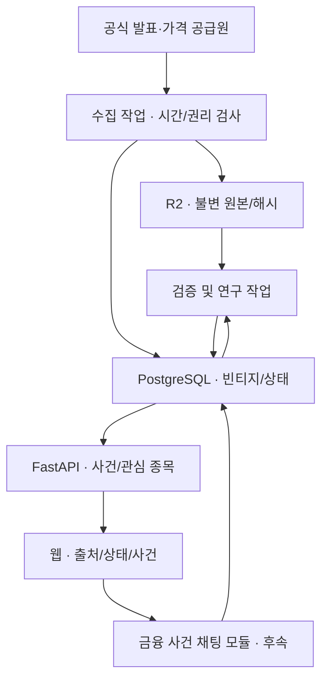

# 사건 중심 제품 구조와 장애 대응 설계

작성일: 2026-10-27. 사용자 제공 `ShockGraph AI — 토스 Learner's High 서버 3기 자료 적용 계획`을 현재 저장소·초안 PR과 대조한 설계다. 이 문서의 목표 구성은 구현·배포 완료를 뜻하지 않는다. 첫 사용자 흐름은 최신 합의와 PR #11에 맞춰 **QQQ·SPY 관심 종목 → 공식 사건 카드 → 같은 기간의 관측 → 사건 대화방**으로 정한다. 자료에 나온 SPY·TLT 종목별 방은 기존 설계 후보이며, TLT의 향후 5·20거래일 변동성 연구는 제품 화면과 별도로 유지한다.

## 변경 전과 변경 후의 책임

| 책임 | 확인된 현재 상태 | 목표와 반영 조건 |
|---|---|---|
| 가격·거시 수집 | main의 작업·R2 불변 원본·중복 거래일 차단과 초안 PR #8~#10의 메타데이터/채점 작업. 별도 실자료 성능 HOLD | 수집 작업이 원본 해시·수신/이용 가능 UTC·원천 권리를 보존하고, 공식 예측과 수정가격 빈티지의 ID를 구분. R2와 PostgreSQL 부분 실패 복구 시험 후 반영 |
| 회원 API | 초안 PR #11의 JWT 검증, 회원별 QQQ·SPY 목록, 공식 사건 연결. CI 격리 PostgreSQL 실연결 시험은 통과 | 실제 doChallenge 로그인 토큰과 서비스 간 키·발급자/대상 계약, 회원 삭제, 준비 상태·DB 장애 응답을 검증한 뒤 서비스 연결 |
| 공개 읽기 | QQQ·SPY의 공식 사건 카드 계약만 구현; 공식 자료 입력과 공개 가격 화면은 없음 | 공식 출처·발표 시각과 자료 이용 가능 시각을 표시. 허가된 관측값이 없으면 결과 대신 `insufficient_data`를 반환 |
| 분석 API | 데이터 원본 감사·TLT 연구 계산은 있으나 사용자용 스냅샷 읽기 API·지연 기준선 없음 | 검증된 버전별 스냅샷을 읽기 전용으로 제공. 캐시 도입 전 동일 부하에서 p50/p95, DB 호출 수·오류율을 측정 |
| 채팅 | doChallenge PR #6의 **운동 모임 방** JWT CONNECT/SUBSCRIBE/SEND 검사는 초안. 금융 사건 방·공개 읽기·신고·차단은 없음 | 금융 사건 ID를 기준으로 공개 읽기/로그인 쓰기, 메시지 영속 저장 후 전송, 커서 복구, 신고·삭제·전송 제한·다중 세션 시험이 모두 끝난 뒤 노출. 기존 모임 권한을 그대로 이식하지 않음 |

### 목표 구성과 데이터 흐름

현재 구현은 수집·감사 경로와 **초안** 회원 API까지다. 그림의 공개 웹, 분석 스냅샷, 금융 채팅은 목표 상태다. 캐시는 검증된 응답을 대상으로 실제 병목이 확인되면 API와 DB 사이에 버전 키로 추가한다. Redis를 원본 저장소로 쓰지 않는다. Kafka는 R2 원본 검증 뒤 DB 아웃박스에 확정한 사건을 정규화/분석 작업에 전달하는 후보로 허용한다. Kafka 발행기·소비자·브로커 운영은 아직 구현하지 않았고, [Kafka 도입 계약](kafka-event-pipeline-decision.md)의 장애·재처리 시험을 통과할 때에만 사용자 기능에 반영한다. Kubernetes·독립 서비스별 MSA는 초기 범위 밖이다. 기존 doChallenge 저장소의 인증·채팅 코드는 참고 및 연동 후보이지 ShockGraph에 금융방이 배포됐다는 뜻이 아니다. 별도 Spring 실행체가 필요한 경우 운영 경계와 `AGENTS.md`의 단일 모듈형 저장소 원칙을 먼저 검토한다.

## 상태와 중복의 기준

| 단위 | 같은 것으로 보는 키 | 재실행 처리 |
|---|---|---|
| 수집 시도 | 공급자·대상 거래일·요청/캡처 ID | 같은 요청이면 중복 저장을 막되, 새로 확인된 수정가격 빈티지는 별도 보존 |
| 불변 원본 | 원본 객체 키·내용 해시·수신 UTC | 기존 객체와 해시가 다르면 덮어쓰지 않고 충돌로 중지 |
| 공식 예측 | 종목·시작 거래일·기간·모델 버전·공식 선택 규칙 | 경쟁 실행에서도 공식 선택은 하나, 비공식 재실행은 감사 이력으로만 유지 |
| 사후 정답 | 예측 ID·채점 종료 거래일·사후 가격 빈티지 ID | 5일과 20일의 정답 준비를 별도로 판정, 아직 닫히지 않은 정답은 HOLD |
| 채팅 전송 | 방 ID·검증된 회원 ID·client_message_id | 동일 전송의 재시도는 기존 메시지 ID를 반환; WebSocket 전송 자체의 정확히 한 번 전달은 주장하지 않음 |

R2 쓰기와 PostgreSQL 기록을 한 트랜잭션으로 포장하지 않는다. 원본 저장 성공 후 DB 실패 시 객체 해시와 작업 ID로 `pending_reconcile` 상태를 추적하고, 재처리는 무결성을 재검증한 뒤 메타데이터만 채운다. 반대 순서의 실패에서는 공식 선택/공개 상태로 전환하지 않는다. 이 상태와 복구 경로는 **설계**이며 구현·동시성 시험 전에는 완료로 표시하지 않는다. 웹에 `ready`, `stale`, `insufficient_data`, `unavailable`과 기준 UTC·출처·권리 상태를 명시하고, 잘못된 데이터를 최신 정보로 조용히 대체하지 않는다.

## 장애 대응 시나리오와 검증 조건

| 고장·주입 방법 | 감지 신호 | 사용자/작업 응답과 복구 | 완료 시험 |
|---|---|---|---|
| 공급원 429·제한된 테스트 응답 | 429 수, Retry-After, 공급자별 실패율 | 정책상 허용된 제한 재시도·backoff, 횟수/시간 상한. 수집 지연을 기록하고 기존 값을 당일 신규 값처럼 제시하지 않음 | 반복 429에서도 요청 폭증·무한 실행 없음, 중복 캡처 없음 |
| 공급원 500·timeout·연결 해제 | 요청 경과 시간, 실패 시작/종료 UTC | 타임아웃과 제한 재시도 후 해당 작업 실패. 마지막 검증본의 시각을 명시하거나 결과 없음 | 끊긴 응답을 주입해 유한 시간 안에 끝남, 작업 재개 시 멱등 |
| 스키마 변경·결측·미래 시각 | 파서 실패, `available_at` 검증 오류 | 후보 데이터를 격리하고 원본만 감사 가능하게 보관. 분석/발표 완료 상태로 전환 금지 | 잘못된 자료로 사건 상태·정답·공개 수치가 생성되지 않음 |
| R2 성공·PostgreSQL 실패 또는 역순 | 객체 해시와 DB 기록/상태 불일치 | 불완전 상태 경고, 원본 재검증 뒤 재처리. 수동 검토 전 공식 예측·표본 수 증가 금지 | 두 실패 지점의 장애 주입, 동일 재실행·동시 실행의 공식 선택 수 불변 |
| Kafka 중단·확인 후 재시작(도입 후) | 미발행 아웃박스 수·지연, 소비 중복 수 | 브로커 중단 동안 DB 아웃박스 유지. 복구 뒤 다시 발행하되 소비자 DB 멱등 키로 결과 한 건만 유지 | 발행 전/후 중단, 중복·역순·오프셋 재처리에서 원본/공식 시작일 불변 |
| PostgreSQL 중단 | DB 연결 오류·준비 상태 실패·API 5xx | 관심 목록/사건 조회는 명확한 503. 다른 회원 자료나 임의 빈 목록으로 대체하지 않음 | DB 차단·복구 시험, 503과 정상 복구, 회원 격리 유지 |
| 캐시 지연·Redis 중단(도입 후) | hit/miss, 스냅샷 ID 불일치, p95 | 검증된 DB 스냅샷으로 폴백 또는 명확한 503. 다른 버전의 응답을 최신으로 혼용 금지 | 버전 갱신·TTL·동시 미스·장애 주입, 원본/DB 무결성 유지 |
| JWT 만료·키 불일치·회원 삭제 | 401/403 비율, 서명 실패 | 쓰기 거절. 공개 읽기는 익명 규칙으로만 처리하고 타인 식별자 사용 금지 | 실제 발급 토큰, 위조·만료·다른 회원, 키 교체와 삭제 후 권한 시험 |
| 채팅 저장 실패·WS 끊김·중복 전송 | DB 쓰기 실패, 재접속·중복 ID 수 | 저장 성공 전 방송 금지. 재접속 시 커서 이후 조회, 동일 ID 재시도는 한 번만 저장 | 두 기기 동시 사용·새로고침·서버 재시작·연속 재전송·사칭 거절 |
| 채팅 도배·유해 글·신고 | 방별 전송 제한, 신고·삭제 기록 | 로그인 쓰기 제한, 신고/차단/삭제 운영 절차와 감사를 제공 | 미인증 전송·차단 우회·삭제 후 조회/실시간 전파 시험 |

운영 로그에는 요청 ID, 단계, 상태, UTC, 원본 **해시의 안전한 참조**만 남긴다. 토큰, R2 키/계정, 원본 가격, 회원 개인정보, 비공개 MAE/CI는 로그에 기록하지 않는다. 알림은 `실패율·누락 거래일·자료 기준 시각·DB/R2 불일치·API p95·채팅 저장 실패`부터 시작한다. 임계값은 운영 기준선을 측정한 뒤 정하며 현재 성과 수치가 아니다.

## 기능 반영 순서와 승인 조건

1. **지금:** 이 구조와 장애 주입 시나리오를 리뷰 가능한 문서로 확정. 기존 CI의 격리 PostgreSQL 연결 성공은 회원 API 실DB 시험에 한정한다.
2. **공개 사건/관측:** 공식 이벤트 출처·시각·가격 표시 권리 및 같은 구간의 QQQ/SPY 자료가 확보되면 상태를 갖춘 읽기 API와 최소 화면을 만든다. 데이터가 없으면 빈 화면/미확보 상태를 정직하게 표시한다.
3. **채팅 MVP:** 방 ID와 권한, 메시지 저장·커서 조회·WebSocket·신고/차단·전송 제한 및 실제 로그인 토큰의 통합 시험을 통과한 기능만 노출한다. 공개 읽기/로그인 쓰기 정책을 모임 채팅과 분리한다.
4. **정합성·관측:** 객체/DB 부분 실패 주입과 복구 후 메타데이터 상태를 승인한다. p50/p95·DB 쿼리 수를 동일한 부하에서 측정하고 필요성이 확인된 때에만 버전별 Redis 캐시를 별도 PR로 추가한다.
5. **연구 병행:** TLT 일별 5·20거래일 미래 변동성은 동일한 예측 시작일·데이터 이용 가능 시각·정답 정의로 A/B를 비교한다. 첫 5일 정답이 실제로 도착하고 독립 표본이 충분해질 때까지 실전 성능·사용자 수요는 HOLD다.

각 기능 PR은 실패 재현, 변경 전 수치(없으면 미측정), 기술 선택, 장애 시험, 변경 후 결과, 운영 한계를 기록한다. 기능이 갖춰졌다는 조건은 **구현 + 시험 + 권리 확인 + 배포 환경 확인**이며, 문서에 적었다는 이유로 자동 출시하지 않는다. 초안 PR의 병합·배포·공개 성능 발표는 별도 판단으로 남긴다.
