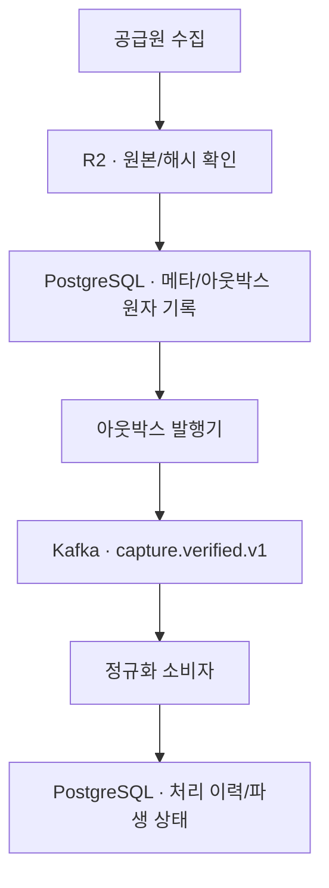

# Kafka 수집 사건 전달 구조와 검증 계약

작성일: 2026-10-27. 사용자 결정에 따라 Kafka의 일괄 제외를 철회한다. 목적은 포트폴리오에서 **금융 원본의 정확성을 해치지 않으면서 비동기 작업을 설계·구현·측정**하는 것이다. 이 문서는 도입 계약이며 브로커·발행기·소비자가 이미 작동한다는 보고가 아니다.

## 첫 적용 지점

`infra/postgres/migrations/0002_day03_04.sql`의 `ingestion_outbox`는 **스키마만** 있다. R2 원본 쓰기·해시 검증 성공 뒤 메타데이터와 아웃박스 한 행을 같은 DB 트랜잭션에 기록하는 코드가 먼저 필요하다. Kafka에는 가격·호가·계정·JWT·비공개 점수를 싣지 않고 `event_id`, `capture_id`, 원본 해시의 안전한 참조, `schema_version`, `occurred_at`(UTC), `asset`, `origin_session` 같은 **읽기/처리 대상의 식별자**만 보낸다. 소비자는 R2/DB를 다시 검증한 후 파생 상태를 만든다. 허가된 원본만 읽고 사용 권리·시각 검사에 실패하면 공개 상태로 전환하지 않는다.

단일 토픽 `shockgraph.capture.verified.v1`을 첫 범위로 한다. 파티션 키는 `asset + origin_session`으로 하여 같은 자산·거래일의 순서를 유지하되 전체 토픽의 전역 순서는 가정하지 않는다. `event_id`는 아웃박스 UUID와 같고, 소비자의 `processed_event_id`를 DB 고유 키로 두어 재전달 시 두 번째 처리를 차단한다. 새로 수정된 가격 빈티지는 다른 `capture_id`로 보존하되 공식 예측의 고유 시작일 수를 늘리지 않는다. `published_at`은 Kafka 브로커의 확인 뒤에만 기록한다. 이 둘 사이에 프로세스가 죽으면 다시 발행될 수 있으므로 **최소 한 번 전달**로 설명한다. Kafka와 PostgreSQL이 원자적으로 커밋된다고 주장하지 않는다.

## 기존 작업과 사용자 API의 경계

- 예약 수집과 기존 R2 감사·공식 채점은 Kafka 없이도 계속 돌아가야 한다. 사용자 API는 Kafka를 직접 조회하지 않고 PostgreSQL에 검증된 상태만 읽는다.
- 채팅 메시지는 영속 저장 후 클라이언트에 보내는 경로를 먼저 구현한다. Kafka를 채팅의 메시지 원장이나 브라우저 전달 성공 보장으로 사용하지 않는다. 다중 서버 팬아웃 필요성이 실제로 생기면 별도 설계·측정한다.
- Redis는 조회 응답 캐시일 수 있으나 금융 원본·Kafka 재처리 기준 저장소가 아니다. RabbitMQ를 Kafka와 나란히 운영하지 않는다. Kubernetes는 이 결정의 범위에 없다.
- 처음에는 단일 노드 개발 환경과 격리된 CI 브로커로 시험한다. 운영 브로커 구성·비용·접근 제어·보관기간·업그레이드·모니터링은 배포 전 별도 검토한다.

## 실패와 재처리 계약

| 주입 지점 | 기대 상태 | 시험해야 할 증거 |
|---|---|---|
| R2 쓰기·해시 검증 실패 | 메타/아웃박스에 `verified` 사건 없음 | Kafka 게시 0회, 원본 오류 기록, 공식 선택 변화 없음 |
| R2 성공 후 DB 트랜잭션 실패 | 원본은 감사 가능하지만 공식 후속 처리 불가 | 불완전 상태 탐지와 재조정 뒤 한 행만 기록 |
| DB 아웃박스 기록 후 브로커 중단 | 미발행 행 유지, 수집/사용자 읽기 비차단 | 브로커 복구 후 같은 ID 발행, 대기 시간·건수 측정 |
| Kafka 확인 후 `published_at` 기록 전 중단 | 같은 사건 재발행 가능 | 소비자 DB 멱등 키로 파생 기록 1건, 독립 시작일 증가 없음 |
| 소비자 DB 쓰기 전/후 중단 | 확인 전에는 재처리; DB 커밋 뒤 재전달은 무해 | 오프셋 재설정/재시작, 원본 해시 일치, 처리 결과 한 건 |
| 역순·다른 가격 빈티지 도착 | 유효한 빈티지 모두 감사 가능, 공식 선택 불변 | 두 빈티지의 원본 보존과 공식 선택 규칙 시험 |
| 스키마 불일치·반복 실패 | 무한 재시도 금지, 오류와 재처리 필요 상태 격리 | 한정 재시도, 실패 목록/운영자 복구, 민감 페이로드 미출력 |

관측 항목은 미발행 아웃박스 수·가장 오래된 행의 나이, 발행 성공/실패, 토픽 지연, 소비자 중복 차단, 실패 격리 수, 원본 해시 불일치다. 임계값·처리량·지연 개선율은 구현 뒤 같은 입력·동일 부하로 측정하며 수치를 미리 만들어내지 않는다.

## 구현 단위와 완료 정의

1. **기반 PR:** R2 완료 뒤 메타·아웃박스 원자 기록, 충돌·부분 실패·동시 실행 시험. 기존 예약 수집을 깨지 않는다.
2. **Kafka PR:** 개발용 브로커, 안전한 참조만 담은 버전 계약, 아웃박스 발행기, 멱등 소비자, 독립 CI 브로커와 재시작/중복/역순 장애 주입. 단순 `produce/consume` 데모만으로 완료하지 않는다.
3. **연결 PR:** 소비 결과가 검증된 분석 스냅샷의 준비 상태를 바꿀 때 읽기 API와 연결. 공급자 자료의 표시 권리·기준 시각·복구가 끝나기 전에는 공개 값으로 승격하지 않는다.

각 PR에 변경 전의 실제 동기 작업 지연/실패와 Kafka 도입 후의 p50/p95, 발행·처리 지연, 중복 차단과 복구 시간을 같은 조건에서 기록한다. 첫 사용자 화면과 금융 채팅을 Kafka 준비 때문에 불필요하게 막지 않는다. 모델 A/B의 미래 성능과 사용자 수요는 별도 HOLD다.
