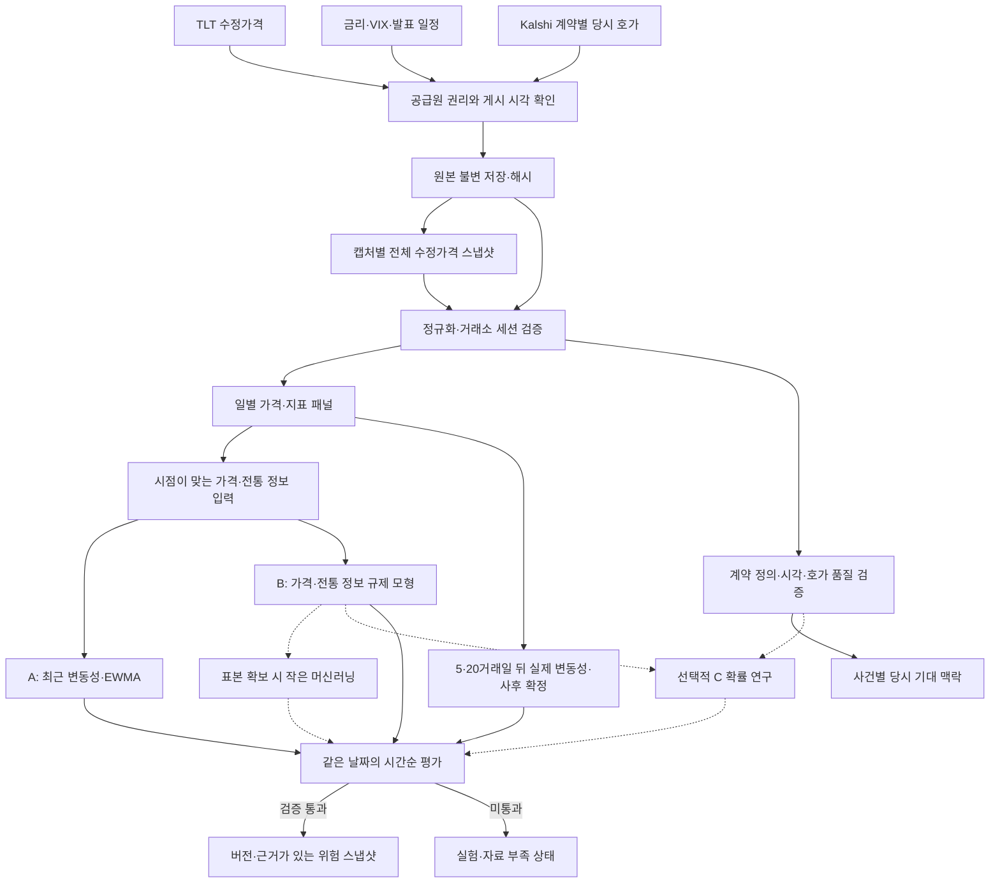
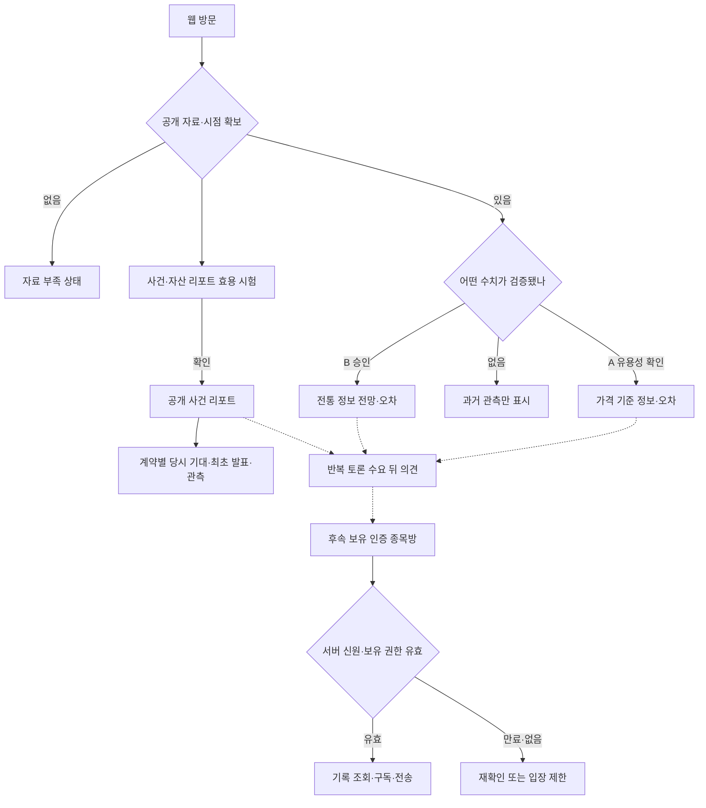

# ShockGraph AI 프로젝트 흐름도

개정일: 2026-10-20. 이 문서는 **목표 흐름과 현재 구현 상태**를
함께 표시한다. 실선은 목표 경로, 점선은 검증 후 확장할 경로다. 화살표는 작업 순서와
데이터 의존성을 뜻하며, 모든 단계가 배포됐다는 의미는 아니다. 제품의 주 경로는
TLT 가격 기준선 A와 전통 정보 모델 B의 미래 변동성 검증이다. Kalshi 계약의
발표 전 확률은 사건에 대한 당시 기대를 설명하는 별도 경로이며, 기존 CPI 계약
적중률 감사와 확률 추가 C 입력 패널은 선택적 연구 이력으로 보존한다.

## 1. 일별 위험 데이터와 분석

- 첫 실증 입력은 TLT 수정 종가와 시점이 맞는 금리·VIX·발표 일정 등의
  **공통 날짜**다. 같은 날의 A/B를 비교하고, 충분한 독립 표본이 쌓이면 B와
  같은 입력의 머신러닝을 검토한다. 브렌트 등은 시점·이용권 확인 후 후보에 넣는다.
- `prediction_at` 이전에 이용 가능한 **가격 버전·전통 지표**만 첫 모델의
  특징량으로 쓴다. Kalshi 맥락은 계약별 `available_at <= 관측 기준시각 < release_at`을
  만족한 발표 전 호가와 계약 정의를 표시하고, 나중의 공식 결과·정산값을 당시
  기대처럼 소급하지 않는다. 확률 없는 날짜를 0%로 채우지 않는다.
  예측 시각까지 실제 캡처된 전체 수정가격 파일 하나를 고르며, 과거 날짜끼리
  서로 다른 조정 버전을 섞지 않는다.
  `t+1`부터 `t+h`까지의 정답은 구간 종료 및 원천값의 이용 가능 시각 이후에만
  평가·학습에 들어간다. 분할 경계를 넘는 정답은 학습에서 제거한다.
- 원본·모델 산출물은 S3 호환 저장소, 정규화된 시계열과 모델·예측 메타데이터는
  PostgreSQL/TimescaleDB를 목표로 한다. 수집·분석은 독립 실행 작업으로 두고
  API 요청마다 재학습하지 않는다. Redis·RabbitMQ는 실제 필요와 도입 조건을
  확인한 뒤 추가한다. Kafka·Kubernetes는 초기 범위 밖이다.
- 비교 지표는 동일 표본의 MAE·QLIKE와 비중첩 구간 수, 겹치는 정답을 고려한 불확실성이다.
  B의 A 대비 성과와
  A의 절대 오차·안정성·사용자 효용은 각각 따로 판단한다.

## 2. 사용자가 보는 서비스 흐름

초기에는 로그인 없이 **검증된 위험 정보 또는 효용이 확인된 사건 리포트의 상태**를
보는 웹을 목표로 한다. 두 가치는 각각 시험하며 한쪽의 미통과가 다른 쪽의
표시를 막지 않는다.
`HOLD`는 자료 부족이고, B의 성능이 부족하거나 불확실한 상태와 구분한다.
B가 검증되지 않으면 A의 오차·안정성·이용권을 확인해 기준 정보로 제공할지
판단한다. 어떤 수치도 검증되지 않으면
과거 관측만 표시한다. 기존 금융 도구·Notion을 이용한
수동 조사와 비교해 시간·오류를 줄인다는 근거가 없으면 리포트를 제품으로
출시하지 않는다. 비동기 의견은 유용한 분석 결과에 대한 반복 토론 수요와 운영
부담을 확인한 뒤에만 출시 여부를 결정한다. 실시간
종목방으로 자동 전환하지 않는다. [성과별 제품 결정](product-goal-and-fallback.md)에
구체적인 기준을 기록한다. 모바일 앱은 같은 API를 공유할 수 있으나 현재 구현
대상이 아니다. 공동 포트폴리오 위험은
자산별 변동성의 단순 가중합으로 대체하지 않는다. 합성 공동 수익률 기준선은
[포트폴리오 위험 방법론](portfolio-risk-methodology.md)에 정리했다. 점선의 포트폴리오 서비스와 종목방은
후속 단계다. 채팅에서는 REST 조회뿐 아니라 WebSocket 연결·구독·전송마다 서버가
신원과 유효한 종목 권한을 확인해야 한다. 보유 인증 공급원과 계약이 확보되기
전에는 ‘인증 주주’ 배지를 표시하지 않는다.

기존 CPI/Kalshi의 **계약 적중률** 감사는 별도 연구로 유지한다. Kalshi의 계약별
당시 확률은 권리와 시각이 확인된 경우 사건 설명으로만 사용한다.
채팅 글은 검증된 모델 근거나 매매 권유로 취급하지 않는다.

## 3. 현재 상태와 다음 연결 조건

| 단계 | 현재 상태 | 다음 조건 |
|---|---|---|
| 데이터 권리·TLT 실가격·거래소 달력 | 실제 TLT 수정종가 이력 한 벌로 비공개 탐색 비교 진행, 과거 가격 버전·권리 미확보로 엄격한 예측 실증 HOLD | 공급원별 시점별 원시 종가·기업행동 샘플, 연구·외부 표시 권리, 여러 해의 실제 세션 확인 |
| 원본 보존·멱등 정규화 | 기존 연구용 인터페이스·스키마 존재 | 새 일별 공급원 어댑터와 원본 계보 연결 |
| 5·20일 변동성·EWMA·정답 시점 검사 | 합성 데이터와 전체 수정가격 스냅샷의 시점 선택, 비공개 시간순 평가 보고 구현·테스트 | 허가된 여러 해의 가격 빈티지로 실제 결측·누수와 통계 안정성 점검, 필요하면 원시 종가+시점별 기업행동 계약 구현 |
| 가격만 쓰는 첫 학습 모델 | 2023년 말 이전 결과로 학습하고 2024년 이후 같은 TLT 날짜에서 비교, 두 기간 모두 기존 방식보다 MAE가 커서 미승인 | 당시 이용 가능한 원시 자료를 확보하고 새 입력의 추가 가치를 별도 비교 |
| 가격·전통 지표의 A/B 실자료 비교 | 보관 가격·지표의 시점별 결합, 홀드아웃 시작 시점의 학습 정답과 사후 시험 정답 분리, 같은 날짜 A/B 채점·결측과 표본 부족 점수 보류를 합성 시험으로 검증. 실자료 B 성능은 미확보 | 실제 가격·전통 지표의 공통 날짜·이용권·게시 시각을 확인하고 B를 새 독립 기간에 A와 비교 |
| Kalshi 계약 기대 맥락 | 단일 계약 확률의 합성 시점 결합과 기존 CPI 계약 감사가 있으나 서비스 표시 권리 미확인 | 계약 문구·임계값·원본 시각·호가 품질·표시 권리 확인 후 사건 설명에만 사용 |
| B와 같은 입력의 머신러닝 비교 | 미구현 | 충분한 독립 표본과 A/B 평가 후 적용. 확률 결합 C는 별도 연구로 보류 |
| 자동 사건·자산 분석 리포트·위험 스냅샷·FastAPI·Next.js | 미구현 | 공개 데이터 권리·이벤트 원본 시점, 동일 과제의 수동 조사 대비 시간·오류 개선, 실자료 성능별 화면 분리 |
| 리포트별 비동기 의견·신고 | 미구현 | 리포트의 실제 사용과 토론 수요 확인, 출처·시각 계약과 운영 정책 검증 |
| 포트폴리오 공동 위험 | 합성 가격의 공동 수익률·EWMA 기준선과 사후 평가 구현, 제품 미연결 | 복수 자산의 허가된 실가격·공통 시점·상관 변화와 표본 외 검증 |
| 보유 인증 종목방 | 미구현 | 허가된 인증 공급원, 만료·취소, 채팅 권한·운영 검증 |

실자료 기반 분석 순서는 **TLT·전통 정보 공통 표본 → 5·20일 A/B →
충분한 표본이면 같은 입력의 머신러닝**이다. Kalshi의 계약별 기대 설명과
시점이 맞는 사건·자산 리포트의 수동 조사 대비 가치는
이 실험과 병행해 시험할 수 있으며, **모형별 검증을 통과한 수치만** 더한다.
리포트가 유용하고 토론 수요가 있을 때만 비동기 의견을 검토하고, 별도 인증·
운영 게이트 뒤에만 종목방을 연다.
합성 포트폴리오 계산 기준선은 선행 구현했다. 기존 확률 결합 C의 코드는
보존하지만 첫 제품의 A/B 판정이나 출시 일정에 포함하지 않는다.

관련 상세 문서: [일별 위험 방법론](daily-risk-methodology.md),
[논문 기반 TLT 모델 설계](tlt-volatility-model-design.md),
[포트폴리오 위험 방법론](portfolio-risk-methodology.md),
[모델·API·메시지 큐 프로그램 구조도](architecture.md#새-프로그램-구조-일별-etf-위험),
[제품 화면](product-ui-direction.md),
[주주 인증 채팅 후속 설계](shareholder-community-roadmap.md).
