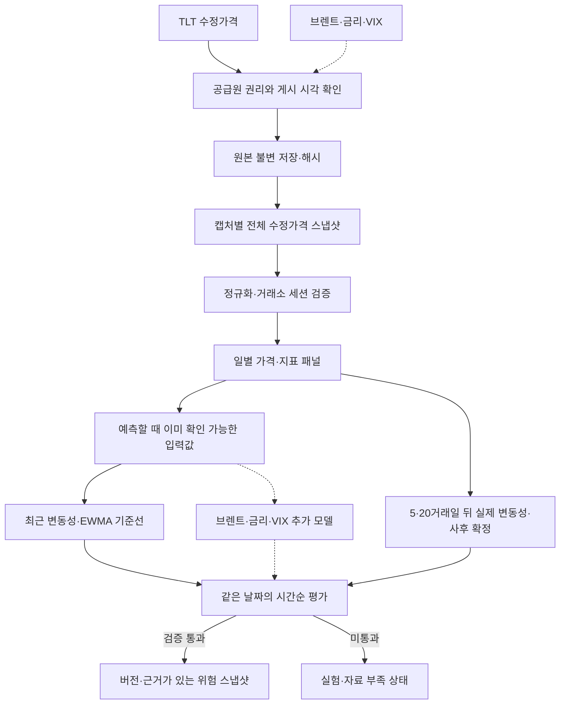
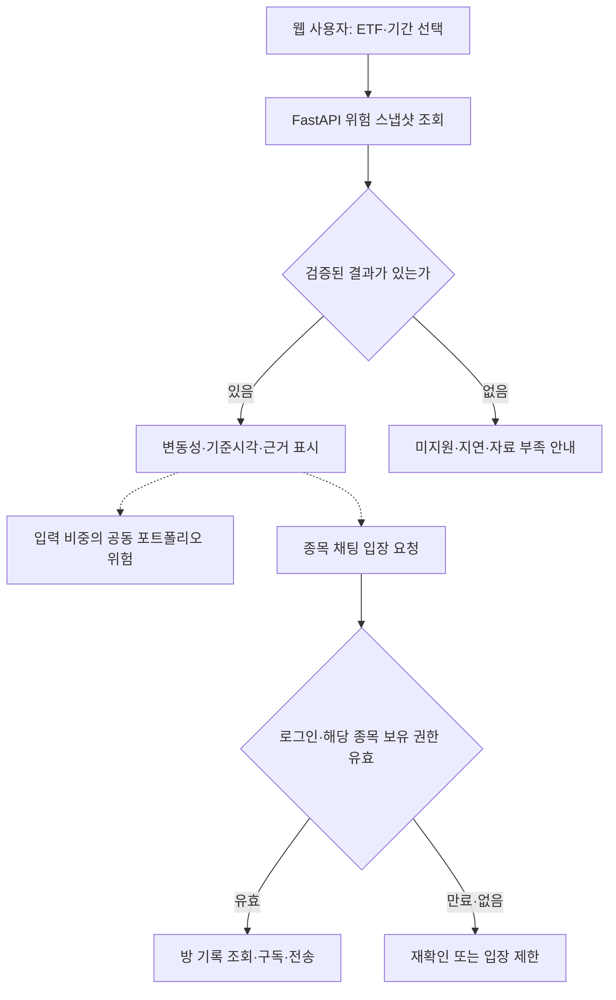

# ShockGraph AI 프로젝트 흐름도

작성일: 2026-10-19. 이 문서는 방향 전환 이후의 **목표 흐름과 현재 구현 상태**를
함께 표시한다. 실선은 목표 경로, 점선은 검증 후 확장할 경로다. 화살표는 작업 순서와
데이터 의존성을 뜻하며, 모든 단계가 배포됐다는 의미는 아니다. 제품의 주 경로는
일별 ETF 위험이며 CPI/Kalshi는 별도 이벤트 연구다.

## 1. 일별 위험 데이터와 분석

- 첫 입력은 TLT 수정 종가다. 브렌트·금리·VIX는 동일한 시점 계약을 충족한 뒤
  **기준선에 대한 증분 성능**을 확인한다. 선물과 현물, 관측일과 게시 시각을 섞지 않는다.
- `prediction_at` 이전에 이용 가능한 **가격 버전과 지표**만 특징량으로 쓴다.
  예측 시각까지 실제 캡처된 전체 수정가격 파일 하나를 고르며, 과거 날짜끼리
  서로 다른 조정 버전을 섞지 않는다.
  `t+1`부터 `t+h`까지의 정답은 구간 종료 및 원천값의 이용 가능 시각 이후에만
  평가·학습에 들어간다. 분할 경계를 넘는 정답은 학습에서 제거한다.
- 원본·모델 산출물은 S3 호환 저장소, 정규화된 시계열과 모델·예측 메타데이터는
  PostgreSQL/TimescaleDB를 목표로 한다. 수집·분석은 독립 실행 작업으로 두고
  API 요청마다 재학습하지 않는다. Redis·RabbitMQ는 실제 필요와 도입 조건을
  확인한 뒤 추가한다. Kafka·Kubernetes는 초기 범위 밖이다.
- 비교 지표는 동일 표본의 MAE·QLIKE와 표본 수, 겹치는 정답을 고려한 불확실성이다.
  복잡한 모델이 기준선을 개선하지 못하면 스냅샷을 `ready`로 승격하지 않는다.

## 2. 사용자가 보는 서비스 흐름

초기에는 로그인 없이 **공개 분석**을 보는 웹을 목표로 한다. 모바일 앱은 검증된
분석 API를 공유할 수 있으나 현재 구현 대상이 아니다. 공동 포트폴리오 위험은
자산별 변동성의 단순 가중합으로 대체하지 않는다. 합성 공동 수익률 기준선은
[포트폴리오 위험 방법론](portfolio-risk-methodology.md)에 정리했다. 점선의 포트폴리오 서비스와 종목방은
후속 단계다. 채팅에서는 REST 조회뿐 아니라 WebSocket 연결·구독·전송마다 서버가
신원과 유효한 종목 권한을 확인해야 한다. 보유 인증 공급원과 계약이 확보되기
전에는 ‘인증 주주’ 배지를 표시하지 않는다.

CPI/FOMC와 Kalshi의 기존 확률 분석은 별도 연구로 유지한다. **일별 위험 기준선에
추가했을 때 동일 시험 기간의 성능이 개선되는 경우에만** 발표일 보조 설명으로
연결한다. 채팅 글도 검증된 모델 근거나 매매 권유로 취급하지 않는다.

## 3. 현재 상태와 다음 연결 조건

| 단계 | 현재 상태 | 다음 조건 |
|---|---|---|
| 데이터 권리·TLT 실가격·거래소 달력 | 실가격·권리 미확보, 2026년 예정 Nasdaq 세션 검사만 구현 | 공급원의 연구·서비스 이용 범위, 과거 파일 캡처와 실제 세션 확인 |
| 원본 보존·멱등 정규화 | 기존 연구용 인터페이스·스키마 존재 | 새 일별 공급원 어댑터와 원본 계보 연결 |
| 5·20일 변동성·EWMA·정답 시점 검사 | 합성 데이터와 전체 수정가격 스냅샷의 시점 선택으로 구현·테스트 | 허가된 과거 스냅샷으로 결측·누수 점검 |
| 브렌트·금리·VIX 결합, 표본 외 개선 | 설계만 완료 | 동일 날짜 패널·독립 기간 평가 |
| 위험 스냅샷·FastAPI·Next.js | 미구현 | 실자료 성능과 지원 상태 검증 |
| 포트폴리오 공동 위험 | 합성 가격의 공동 수익률·EWMA 기준선과 사후 평가 구현, 제품 미연결 | 복수 자산의 허가된 실가격·공통 시점·상관 변화와 표본 외 검증 |
| 보유 인증 종목방 | 미구현 | 허가된 인증 공급원, 만료·취소, 채팅 권한·운영 검증 |

실자료 기반 제품 연결 순서는 **TLT 실제 데이터 → 5·20일 기준선 평가 → 시장 변수의 증분 검증 →
분석 API·웹 → 포트폴리오 서비스 → 보유 인증 커뮤니티**다. 합성 포트폴리오 계산
기준선은 선행 구현했다. 시장 변수 추가 모델이
기준선을 넘지 못하더라도 실패 분석을 기록하고 성능을 과장하지 않는다.

관련 상세 문서: [일별 위험 방법론](daily-risk-methodology.md),
[포트폴리오 위험 방법론](portfolio-risk-methodology.md),
[모델·API·메시지 큐 프로그램 구조도](architecture.md#새-프로그램-구조-일별-etf-위험),
[제품 화면](product-ui-direction.md),
[주주 인증 채팅 후속 설계](shareholder-community-roadmap.md).
