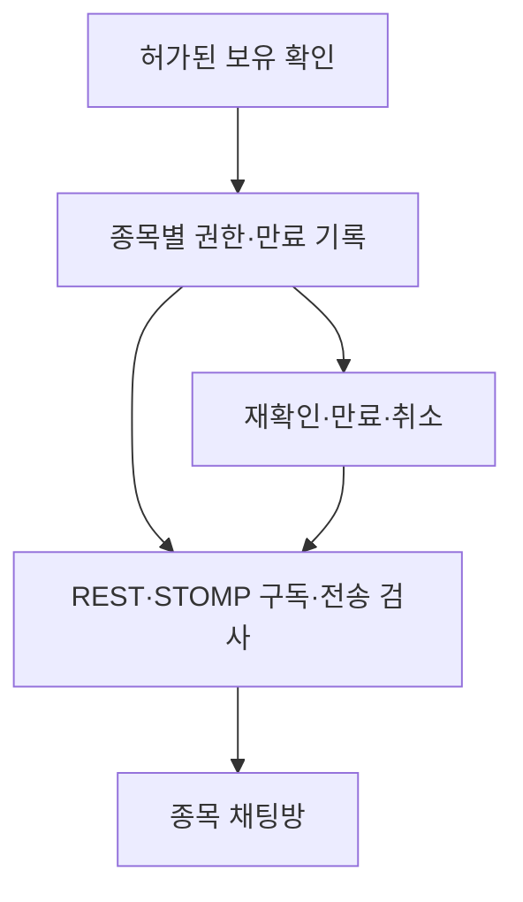

# 주주 인증 종목 채팅 후속 설계

상태: 2026-10-21 후속 주주 인증 설계. 공개 SPY·TLT 채팅은 별도 작은 MVP로 계획했으며, 사용자 인증·채팅 구현과 보유 인증 공급원은 아직 없다.

## 제품 경계

공개 가능한 이벤트 근거와 승인된 위험 분석은 로그인 없이 볼 수 있다. 후속
종목 채팅방은 **로그인 + 해당 종목의 유효한 보유 확인**을 통과해야 조회·구독·
메시지 전송이 가능하다. 이벤트 근거나 분석 카드에서 토론방에 들어가는 흐름을
목표로 한다. 채팅 글은 분석 모델의 근거 데이터나 투자 권유로 자동 승격하지 않는다.

SPY·TLT 종목별 분석 카드에 연결된 **공개 채팅 MVP**는 이 보유 인증과 별도로
시험한다. 그 방은 누구나 읽고 로그인한 사용자가 쓸 수 있지만 인증 주주
배지를 주지 않는다. 후속 **주주 전용 방**은 허가된 확인 공급원, 권한 검사와
운영 역량을 확보한 뒤에만 연다. 공개 채팅의 사용량이 예측 성능이나 주주
인증 가능성을 증명하는 것은 아니다.

‘인증 주주’는 마지막 확인 시점에 해당 종목의 보유가 확인됐다는 뜻이다. 매도 직후까지 지속 보유를 보증하지 않으므로 화면에는 `마지막 인증 시각`과 만료 상태를 보여준다. 종목 식별자는 공급원 코드와 거래소·통화를 포함한 표준 식별자로 매핑한다. 국내 주식과 미국 ETF에 같은 API가 바로 적용된다고 가정하지 않는다.

## 보유 확인 가능성 게이트

- 금융위원회의 [금융 마이데이터 안내](https://www.fsc.go.kr/po010101/84780)는 증권 자산 조회의 공식 경로를 설명하지만, **개별 개발자가 이용자 보유종목을 임의로 조회할 수 있다는 허가**는 아니다. 해당 목적과 데이터 범위를 허용하는 사업자·제휴 경로를 확인해야 한다.
- 한국투자증권 [KIS Developers 이용 대상](https://apiportal.koreainvestment.com/about-devcenter)도 개인 자신의 계좌용 API와 고객 서비스를 위한 제휴 절차를 구분한다. 개인 키를 여러 이용자의 주주 인증 수단으로 받아 서버에 보관하는 설계는 채택하지 않는다.
- 공급원·권리·보유종목 범위가 확정되기 전에는 주주 인증 배지를 제공하지 않는다. 수동 입력이나 계좌 화면 캡처는 소유 검증으로 인정하지 않는다.
- 네이버페이 증권은 [주주 표시·주주오픈톡](https://help.pay.naver.com/faq/list.help?categoryId=11143)을 이미 안내한다. 인증 자체를 신규 서비스의 차별점이라고 가정하지 않는다. 우리 쪽의 검증 가설은 **발표 전 가설의 시각·출처와 발표 후 복기를 연결하는 구조**의 유용성이다.

## 권한과 데이터 계약

보유 확인 어댑터는 사용자의 명시적 동의와 공급원의 허용된 인증 절차를 사용한다. 애플리케이션에는 최소 권한 결과만 남긴다.

| 저장 후보 | 의미 |
|---|---|
| `member_id`, `instrument_id` | 인증된 사용자와 표준 종목 식별자 |
| `provider_ref`, `verified_at`, `expires_at` | 검증 출처의 불투명 참조 및 유효기간 |
| `status`, `revoked_at` | 유효·만료·취소 상태와 갱신 이력 |

채팅 권한 DB에는 계좌번호, 주문·거래내역, 보유 수량, 인증 비밀번호나 증권사 비밀키를 넣지 않는다. 공급원 정책상 일회성 참조 보존도 금지되면 필요한 형태로 줄인다. 권한 상태와 사용자 신원은 서로 다른 사실이므로 JWT에 영구 보유종목 목록을 넣지 않는다.

비동기 공개 글에도 신고·차단·삭제·운영자 감사 기록과 게시·편집 시각을
적용한다. 의견, 공식 발표 자료, 검증된 모델 결과를 별도 유형으로 보여준다.
수익 보장이나 종목별 매매 지시를 유료 방 상품으로 만들지 않는다.
[금융위원회 안내](https://www.fsc.go.kr/no010101/82887)에 따르면 SNS 등
양방향 유료 회원제 투자 조언은 투자자문업 규율을 받는다. 향후 광고·유료화
방식은 실제 제공 행위에 대한 검토 후 정한다.

보유 권한은 HTTP 기록 조회·전송뿐 아니라 WebSocket **CONNECT 시 신원 확인, SUBSCRIBE 시 해당 방 권한, SEND 시 방 권한**으로 검사한다. 기존 연결이라도 권한 만료·취소가 발생하면 구독을 끊고 다음 메시지를 거부한다. SSE 알림에서도 현재 권한과 발신자/방 상태를 검사하고 타 사용자의 계좌 데이터를 알림에 넣지 않는다. 만료 정책은 공급원 갱신 주기·서비스 약속에 맞춰 별도 결정하며 공급원이 확인하지 못한 기간에는 인증 상태를 `stale`로 낮춘다.

## doChallenge 재사용 범위

[doChallenge](https://github.com/AnDev77/doChallenge)의 `ChatService` 분리, MySQL 메시지 원장과 `(room_id,id)` 커서 조회, 읽음 커서, Redis 최근 메시지 캐시, 다중 SSE emitter, WebSocket 세션 종료 cleanup은 참고할 만한 기반이다. 다만 현재 코드에서 WebSocket 요청의 `memberId`를 신원으로 사용하고 `/topic` 구독 검사와 CONNECT JWT 검증이 없으므로 **있는 그대로 재사용하거나 공개 배포하지 않는다.** 방 참여 조건은 모임 가입 대신 `HoldingEntitlement` 검사로 교체한다. 봇·광고·시세 조작 유도 신고, 차단, 운영자 조치와 감사 기록도 새 도메인 요구사항이다.

기술 선택은 커뮤니티 출시 시점에 확정한다. 분석 FastAPI와 별도로 Spring Boot 채팅 경계를 두면 doChallenge 코드 일부를 이식할 수 있지만, 신원 연동과 운영 비용이 생긴다. 초기 분석 MVP에는 채팅 서버, 브로커, Kafka를 추가하지 않는다. 출시 전에는 ① 인증 공급원 계약, ② CONNECT/SUBSCRIBE/SEND 권한 통합 시험, ③ 차단·신고·삭제, ④ 재연결·다중 기기·다중 서버 검증을 통과시킨다.
